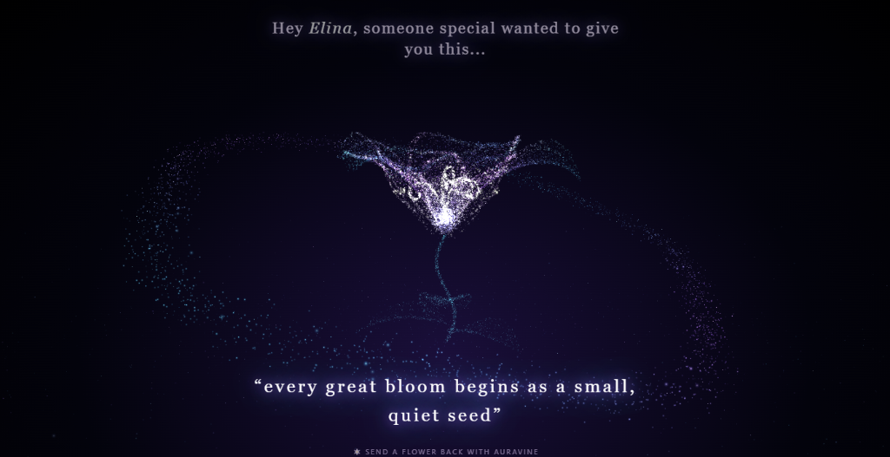
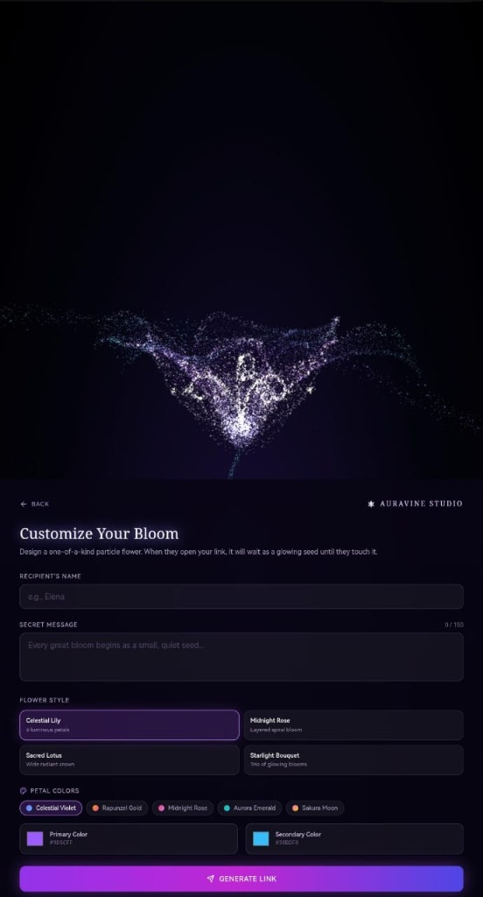
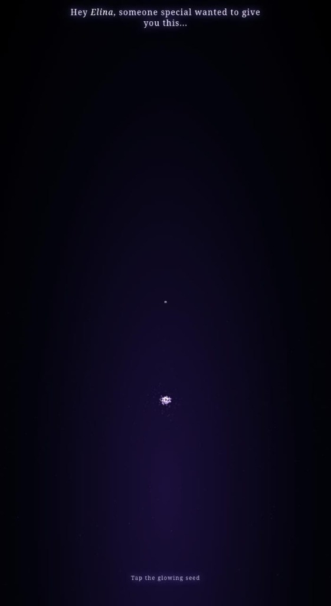
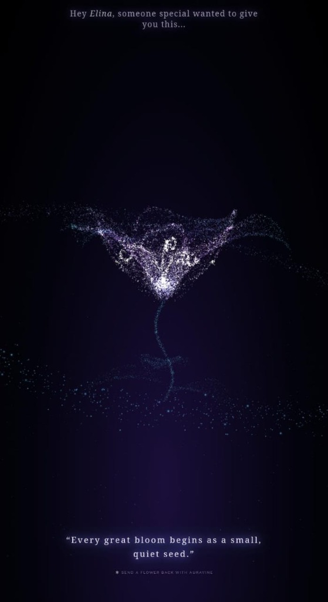

<div align="center">

# 🌸 Auravine

### Send an Eternal Particle Bloom

*Every great bloom begins as a small, quiet seed.*

[**✨ Live Demo**](https://auravine-bloom.netlify.app/) · [**🌱 Create a Flower**](https://auravine-bloom.netlify.app/create) · [**🐛 Report a Bug**](https://github.com/FatihaAlMh/auravine/issues)



</div>

---

## 📖 About

**Auravine** is an interactive digital gifting platform that lets you design and send a personalized, glowing 3D particle flower to someone you love.

Unlike a static e-card, Auravine is a living gift. Each flower is a constellation of **23,800 glowing particles**. Your recipient opens a private link, finds a single glowing seed, and awakens it with a touch. It grows into a full bloom, reveals your hidden message, and scatters like stardust under their cursor or finger.

> *A digital bloom that never wilts.*

## 📸 Screenshots

<div align="center">

### Design your bloom
Pick a flower style, set your colors, and hide a secret message inside.



<br/><br/>

### The gift experience

<table>
  <tr>
    <td align="center">
      <br/>
      <sub><b>1.</b> A glowing seed waits for a touch</sub>
    </td>
    <td align="center">
      <br/>
      <sub><b>2.</b> The flower blooms and reveals the message</sub>
    </td>
  </tr>
</table>

</div>

## ✨ Features

- 🌱 **Awaken the seed**: the gift starts as a single glowing seed. One tap or click brings the flower to life.
- 💫 **Living particle physics**: thousands of individual particles scatter like magical dust under your cursor or finger, then gently reform.
- 🌷 **Four flower styles**: choose from the studio's collection:
  - **Celestial Lily**: 6 luminous petals
  - **Midnight Rose**: layered spiral bloom
  - **Sacred Lotus**: wide radiant crown
  - **Starlight Bouquet**: a trio of glowing blooms
- 🎨 **Custom colors**: start from a preset palette (*Celestial Violet, Rapunzel Gold, Midnight Rose, Aurora Emerald, Sakura Moon*) or pick your own primary and secondary colors.
- 💌 **Hidden secret message**: write up to 150 characters that fade in once the flower has bloomed.
- 👤 **Personal greeting**: the receiver is welcomed by name: *"Hey Elina, someone special wanted to give you this..."*
- 🔗 **Private, unique links**: every gift gets its own shareable URL.
- 💐 **Send one back**: every gift ends with a *"Send a flower back with Auravine"* link, so the receiver can reply with a bloom of their own.
- 📱 **Mobile-first**: no app to install. Open the link and the magic starts in the browser.

## 🛠️ Tech Stack

| Layer | Technology |
| --- | --- |
| Framework | Next.js (React) |
| Styling | Tailwind CSS |
| Graphics | WebGL (Three.js) |
| Database | Firebase / Supabase |
| Hosting | Netlify |

## 🧠 How the Particle System Works

The flower is not an image or a video. It is a mathematical model generated live in your browser.

1. **Target shape**: a set of target coordinates is generated to form the petals, stem, and leaves of the chosen flower style.
2. **Seed**: the particles start gathered in a tiny glowing seed.
3. **Bloom**: once touched, each particle eases toward its target using linear interpolation (`lerp`), which creates the growing and blooming motion.
4. **Interaction**: a repulsion force is applied around the cursor or touch point. Any particle closer than a threshold is pushed away, then drifts back into place.

## 🚀 Getting Started

### Prerequisites

- [Node.js](https://nodejs.org/) v18 or higher
- npm, yarn, or pnpm
- A Firebase or Supabase project (for storing gifts)

### Installation

```bash
# 1. Clone the repository
git clone https://github.com/FatihaAlMh/auravine.git
cd auravine

# 2. Install dependencies
npm install
```

### Environment Variables

Create a `.env.local` file in the project root:

```env
NEXT_PUBLIC_FIREBASE_API_KEY=your_api_key
NEXT_PUBLIC_FIREBASE_AUTH_DOMAIN=your_auth_domain
NEXT_PUBLIC_FIREBASE_PROJECT_ID=your_project_id
```

### Run Locally

```bash
npm run dev
```

Open [http://localhost:3000](http://localhost:3000) and watch it bloom.

## 📁 Project Structure

```
auravine/
├── src/             # Application source code
├── supabase/        # Database schema
├── assets/          # README screenshots
├── package.json     # Dependencies & scripts
└── netlify.toml     # Netlify deployment configuration
```

## ☁️ Deployment

Auravine is deployed on **Netlify** and configured through `netlify.toml`. To deploy your own copy, connect the repository to Netlify and add your environment variables in the site settings.

## 🗺️ Roadmap

- [ ] Ambient sound or music when the flower blooms
- [ ] Scheduled delivery for birthdays and anniversaries
- [ ] Social share preview image for each gift
- [ ] More flower styles and color palettes

## 🤝 Contributing

Contributions, issues, and feature requests are welcome! Check the [issues page](https://github.com/FatihaAlMh/auravine/issues).

1. Fork the project
2. Create your branch (`git checkout -b feature/amazing-feature`)
3. Commit your changes (`git commit -m "Add amazing feature"`)
4. Push to the branch (`git push origin feature/amazing-feature`)
5. Open a Pull Request

## 📝 License

Distributed under the MIT License. See `LICENSE` for details.

---

<div align="center">

Built with 🌸 and a lot of code by [**FatihaAlMh**](https://github.com/FatihaAlMh)

</div>
